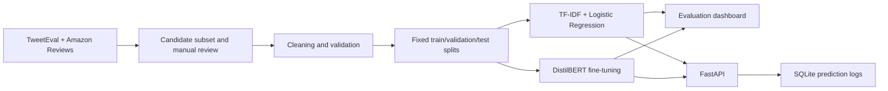

# End-to-End Sentiment Analysis System

An end-to-end three-class sentiment analysis system that classifies English text as `negative`, `neutral`, or `positive`. The project includes manual dataset curation support, two independently trained models, reproducible evaluation, an executed comparison dashboard, FastAPI deployment, SQLite prediction logging, automated tests, and Docker packaging.

## Table Of Contents

- [Project Overview](#project-overview)
- [Architecture](#architecture)
- [Dataset Building And Curation](#dataset-building-and-curation)
- [Preprocessing Pipeline](#preprocessing-pipeline)
- [Model A: Classical ML](#model-a-classical-ml)
- [Model B: DistilBERT](#model-b-distilbert)
- [Results And Comparison](#results-and-comparison)
- [Installation](#installation)
- [Running The Pipeline](#running-the-pipeline)
- [FastAPI Usage](#fastapi-usage)
- [Docker](#docker)
- [Configuration](#configuration)
- [Testing](#testing)
- [Reproducibility](#reproducibility)
- [Limitations](#limitations)

## Project Overview

The system was designed to satisfy a final Python and machine-learning evaluation with these requirements:

- Curate 300-500 examples from each of two open-source datasets.
- Build TF-IDF plus a scikit-learn classifier with GridSearchCV.
- Fine-tune a pretrained transformer with a custom PyTorch loop, scheduler, and early stopping.
- Compare per-class metrics, confusion matrices, speed, size, and training time.
- Serve both models through FastAPI and log predictions to SQLite.
- Use modular code, YAML configuration, reproducible packaging, tests, and detailed documentation.

## Architecture



```text
src/
  data/             Dataset loading, selection, reporting, and splitting
  preprocessing/    ML/DL text cleaning and quality validation
  models/           Classical training, transformer training, and inference
  evaluation/       Metric normalization, comparison tables, and charts
  api/              FastAPI routes, schemas, and SQLite logging
  config/           YAML files for data, ML, DL, and API behavior
  utils/            Shared configuration and logging helpers
tests/              Unit and integration tests
notebooks/          Executed model-comparison dashboard
data/               Curated data, reports, and fixed splits
artifacts/          Model metrics, evaluation outputs, and local model files
docs/               Manual-curation and interview guides
```

Each stage has a command-line entry point. Paths and hyperparameters are stored in YAML rather than hard-coded into training logic.

## Dataset Building And Curation

### Sources

1. [TweetEval sentiment](https://huggingface.co/datasets/cardiffnlp/tweet_eval)
   - Short, noisy social-media text.
   - Includes mentions, hashtags, informal language, and three sentiment labels.
2. [Amazon Reviews Multi English](https://huggingface.co/datasets/SetFit/amazon_reviews_multi_en)
   - Longer product-review text.
   - Provides a contrasting domain with explicit product opinions.

These sources were combined to test whether the models can learn sentiment across both social-media and product-review language instead of overfitting to one domain.

### Label Mapping

- TweetEval: `0 -> negative`, `1 -> neutral`, `2 -> positive`.
- Amazon: `0-1 -> negative`, `2 -> neutral`, `3-4 -> positive`.

### Selection Process

1. Load the training split from each open-source dataset.
2. Normalize text and remove invalid, duplicate, very short, or low-information rows.
3. Select a class-balanced candidate subset using seed `42`.
4. Retain 400 TweetEval rows and 400 Amazon rows.
5. Export ambiguous rows for candidate review.
6. Create a reproducible stratified 70/15/15 split.

The assignment requires a manually prepared subset. The candidate should personally review the selected examples and record `KEEP`, `RELABEL`, or `DROP` decisions before final submission. Automated balanced sampling alone should not be presented as manual review.

### Dataset Statistics

| Statistic | Value |
| --- | ---: |
| Total examples | 800 |
| TweetEval examples | 400 |
| Amazon examples | 400 |
| Negative | 268 |
| Neutral | 266 |
| Positive | 266 |
| Train split | 560 |
| Validation split | 120 |
| Test split | 120 |
| Mean text length | 140.53 characters |
| Median text length | 115 characters |

### Curation Challenges

- Tweets contain abbreviations, hashtags, mentions, links, emojis, and context-dependent sarcasm.
- Reviews may contain both praise and criticism in the same example.
- Star ratings do not always perfectly represent the sentiment expressed in review text.
- Neutral sentiment has less distinct boundaries than positive and negative sentiment.
- Broken unicode, escaped characters, quote-only fragments, and mojibake required explicit handling.

Detailed statistics and decisions are generated in [data/processed/dataset_curation_report.md](data/processed/dataset_curation_report.md).

## Preprocessing Pipeline

The original `text` column is preserved for auditing. Two model-ready columns are generated because classical and transformer models have different preprocessing needs.

| Behavior | `text_clean_ml` | `text_clean_dl` |
| --- | --- | --- |
| Lowercase | Yes | No |
| Accent normalization | ASCII | Preserve valid unicode |
| URLs and mentions | Remove | Remove |
| Hashtag marker | Remove, keep word | Remove, keep word |
| HTML/control characters | Remove | Remove |
| Escaped unicode/mojibake | Repair | Repair |
| Emojis | Remove unsupported symbols | Preserve sentiment signals |
| Repeated whitespace/punctuation | Normalize | Normalize |

Quality validation checks required columns, labels, empty text, low-information rows, URLs, mentions, hashtag markers, unicode escapes, quote junk, underscore runs, mojibake, duplicate normalized text, and split overlap.

```powershell
python -m src.preprocessing.validate_dataset --config src/config/data.yaml
```

The generated report is available at [data/processed/preprocessing_quality_report.md](data/processed/preprocessing_quality_report.md).

## Model A: Classical ML

The classical baseline uses:

- `TfidfVectorizer`
- `LogisticRegression`
- `GridSearchCV`
- Macro F1 as the selection metric

Logistic Regression was selected because it is fast, compact, interpretable, and provides probability estimates for the API. The grid searches n-gram range, maximum features, minimum document frequency, regularization strength, and class weighting.

```powershell
python -m src.models.train_ml --config src/config/ml.yaml
```

Best configuration:

```text
C: 1.0
class_weight: balanced
max_features: 5000
min_df: 2
ngram_range: (1, 1)
```

Artifacts:

- `artifacts/ml/tfidf_sentiment_pipeline.joblib`
- `artifacts/ml/ml_metrics.json`

## Model B: DistilBERT

The transformer model fine-tunes `distilbert-base-uncased` on `text_clean_dl`. DistilBERT was selected because it retains much of BERT's contextual capability while using fewer parameters and supporting practical inference.

The custom PyTorch implementation includes:

- Custom `Dataset`, DataLoaders, training loop, and validation loop.
- AdamW optimizer.
- Linear warmup and learning-rate decay.
- Gradient clipping.
- CUDA mixed precision when available.
- Validation after every epoch.
- Best-checkpoint selection by validation macro F1.
- Early-stopping logic with patience `2`.
- CPU fallback for training and inference.

```powershell
python -m src.models.train_dl --config src/config/dl.yaml
```

Key settings:

```text
max_length: 128
batch_size: 8
epochs: 4
learning_rate: 2e-5
weight_decay: 0.01
warmup_ratio: 0.1
```

Artifacts:

- `artifacts/dl/distilbert_sentiment/`
- `artifacts/dl/dl_metrics.json`

The 256 MB transformer weights exceed GitHub's normal file limit and are intentionally ignored by Git. After cloning, fine-tune the model locally or distribute the checkpoint separately using Git LFS, a release asset, or a model registry.

## Results And Comparison

### Overall Results

| Model | Test Accuracy | Test Macro F1 | Size | Inference |
| --- | ---: | ---: | ---: | ---: |
| TF-IDF + Logistic Regression | 0.5000 | 0.4975 | 0.067 MB | 0.021 ms/sample |
| DistilBERT | 0.6917 | 0.6750 | 256.33 MB | 11.95 ms/sample on GPU |

DistilBERT improves test macro F1 by `0.1775`, approximately `35.7%` relative to the classical baseline.

### Per-Class Test Results

| Model | Class | Precision | Recall | F1 |
| --- | --- | ---: | ---: | ---: |
| Classical ML | Negative | 0.5500 | 0.5500 | 0.5500 |
| Classical ML | Neutral | 0.4167 | 0.3750 | 0.3947 |
| Classical ML | Positive | 0.5227 | 0.5750 | 0.5476 |
| DistilBERT | Negative | 0.7021 | 0.8250 | 0.7586 |
| DistilBERT | Neutral | 0.6154 | 0.4000 | 0.4848 |
| DistilBERT | Positive | 0.7234 | 0.8500 | 0.7816 |

Neutral remains the hardest class. DistilBERT provides substantial improvements for negative and positive sentiment but has higher memory and latency costs.

### Deployment Decision

**DistilBERT is the recommended primary model.** The 35.7% relative macro-F1 improvement justifies its larger artifact for quality-focused deployment, while measured GPU latency remains practical. The classical model remains a low-resource fallback for CPU-only or high-throughput environments.

The executed dashboard with charts, tables, confusion matrices, training history, and written conclusions is available at [notebooks/model_comparison_dashboard.ipynb](notebooks/model_comparison_dashboard.ipynb).

Regenerate comparison outputs with:

```powershell
python -m src.evaluation.evaluate_models
```

## Installation

Python `3.11` is recommended.

### Windows PowerShell

```powershell
git clone https://github.com/FahadAliOfficial/OOP-ml-task.git
cd OOP-ml-task
python -m venv .venv
.venv\Scripts\Activate.ps1
python -m pip install --upgrade pip
pip install -r requirements.txt
```

### Linux Or macOS

```bash
git clone https://github.com/FahadAliOfficial/OOP-ml-task.git
cd OOP-ml-task
python3 -m venv .venv
source .venv/bin/activate
python -m pip install --upgrade pip
pip install -r requirements.txt
```

For an NVIDIA CUDA 12.6 environment, install the matching PyTorch build before the other requirements:

```powershell
pip install torch==2.8.0 --index-url https://download.pytorch.org/whl/cu126
pip install -r requirements.txt
```

## Running The Pipeline

The processed dataset and metrics are included, so retraining is optional unless model files are unavailable.

```powershell
# Build or regenerate the curated dataset
python -m src.data.build_dataset --config src/config/data.yaml

# Validate preprocessing and split integrity
python -m src.preprocessing.validate_dataset --config src/config/data.yaml

# Train the classical model
python -m src.models.train_ml --config src/config/ml.yaml

# Fine-tune DistilBERT
python -m src.models.train_dl --config src/config/dl.yaml

# Regenerate comparison outputs
python -m src.evaluation.evaluate_models
```

Dataset and pretrained-model downloads require internet access. DistilBERT automatically uses CUDA when available and otherwise falls back to CPU.

## FastAPI Usage

Start the API from the repository root:

```powershell
uvicorn src.api.main:app --host 127.0.0.1 --port 8000
```

Open interactive Swagger documentation at [http://127.0.0.1:8000/docs](http://127.0.0.1:8000/docs).

Opening `/predict-ml` or `/predict-dl` directly in a browser sends a GET request and returns `405 Method Not Allowed`. Prediction endpoints require POST requests with JSON.

### Health Check

```http
GET /healthcheck
```

Example response:

```json
{
  "status": "ok",
  "ml_model_available": true,
  "dl_model_available": true,
  "database_available": true
}
```

### Classical ML Prediction

```http
POST /predict-ml
Content-Type: application/json
```

### Transformer Prediction

```http
POST /predict-dl
Content-Type: application/json
```

Example request:

```json
{
  "text": "The product quality is excellent and delivery was fast."
}
```

Example response:

```json
{
  "prediction": "positive",
  "model_used": "tfidf_logistic_regression",
  "inference_time_ms": 0.88,
  "confidence": 0.45
}
```

PowerShell example:

```powershell
Invoke-RestMethod `
  -Method Post `
  -Uri "http://127.0.0.1:8000/predict-ml" `
  -ContentType "application/json" `
  -Body '{"text":"This product is excellent."}'
```

### SQLite Logging

Every successful prediction is written to `logs/predictions.db` in the `prediction_logs` table.

| Column | Meaning |
| --- | --- |
| `timestamp` | UTC insertion timestamp |
| `input_text` | Submitted text |
| `model_used` | ML or transformer model identifier |
| `prediction` | Predicted sentiment |
| `confidence` | Maximum class probability |
| `inference_time_ms` | Measured model latency |

## Docker

The Docker image uses CPU PyTorch for portability and installs the smaller `requirements-api.txt` runtime environment.

The Docker build copies trained model artifacts. Train both models before building if the checkpoint files are not present after cloning.

```powershell
docker build -t sentiment-analysis-api .
docker run --rm -p 8000:8000 -v sentiment-logs:/app/logs sentiment-analysis-api
```

The verified image is approximately `652 MB`. Its health check and both prediction endpoints pass in a CPU container; measured container DistilBERT inference was approximately `112 ms` for the smoke-test input.

## Configuration

| File | Purpose |
| --- | --- |
| `src/config/data.yaml` | Sources, label mapping, paths, seed, and split ratios |
| `src/config/ml.yaml` | TF-IDF and GridSearchCV settings |
| `src/config/dl.yaml` | Transformer, optimizer, scheduler, and early-stopping settings |
| `src/config/api.yaml` | Model paths, API metadata, SQLite path, and table name |

## Testing

The suite covers dataset curation, text cleaning, split integrity, both training pipelines, inference, evaluation charts, notebook integrity, API behavior, SQLite logging, and packaging.

```powershell
python -m pytest
```

Verified result:

```text
47 tests passed
```

## Reproducibility

- Fixed random seed `42` across selection and training.
- Saved stratified train, validation, and test splits.
- Test data used only for final evaluation.
- YAML-controlled hyperparameters and paths.
- Pinned development and API-only dependencies.
- Saved metrics and executed notebook outputs.
- Preprocessing and split-quality validation.
- Docker image with an application health check.

## Limitations

- The curated dataset is small, so metric estimates have uncertainty.
- Neutral sentiment, sarcasm, and mixed opinions remain difficult.
- DistilBERT requires substantially more memory than the classical model.
- Confidence scores are not formally calibrated.
- Authentication, rate limiting, monitoring, and drift detection are outside this evaluation scope.
- Large transformer weights require separate distribution or local retraining when sharing through standard GitHub repositories.

## Final Verification

```powershell
python -m src.preprocessing.validate_dataset --config src/config/data.yaml
python -m pytest
python -m src.evaluation.evaluate_models
python -m jupyter nbconvert --execute notebooks/model_comparison_dashboard.ipynb --to notebook --inplace
uvicorn src.api.main:app --host 127.0.0.1 --port 8000
```
